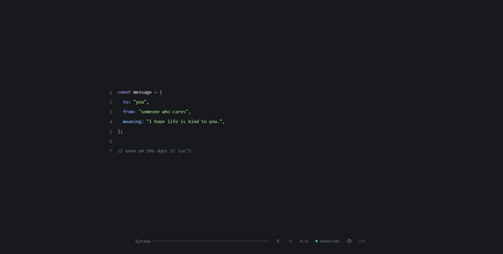

# Syntax

**Turn personal messages into code.**

Syntax is an interactive experience that transforms personal messages into animated code, revealing it one character at a time.

Explore different programming languages, customize the code, and discover the message hidden behind the syntax.



## Features

- **Animated code reveal** — Watch code unfold character by character.
- **Playback controls** — Pause, resume, replay, and adjust animation speed.
- **Automatic language detection** — Detect the programming language from the current code.
- **Multiple languages** — Syntax highlighting for eight programming languages.
- **Import your own code** — Import existing code and provide the original message behind it.
- **Prompt Studio** — Prepare prompts and customize code-generation instructions.
- **Message reveal** — Reveal the original message associated with the code.
- **Code editor** — Edit the code and its original message.

## Supported languages

| Language | Support |
|---|---|
| JavaScript | Syntax highlighting |
| Python | Syntax highlighting |
| JSON | Syntax highlighting |
| TypeScript | Syntax highlighting |
| C++ | Syntax highlighting |
| Java | Syntax highlighting |
| Rust | Syntax highlighting |
| SQL | Syntax highlighting |

Language highlighting is powered by [Prism.js](https://prismjs.com/).

## Getting started

### Requirements

- Node.js
- npm

### Installation

Clone the repository:

```bash
git clone https://github.com/amroklld/Syntax.git
cd Syntax
```

Install dependencies:

```bash
npm install
```

Start the development server:

```bash
npm run dev
```

Open the local URL provided by Vite in your browser.

### Production build

Build the application:

```bash
npm run build
```

Preview the production build locally:

```bash
npm run preview
```

## Safety

Syntax displays code as text. Imported or generated code is **never executed**.

## Built with

- React
- Vite
- Prism.js
- JavaScript
- CSS

---

**Syntax** — Messages expressed through code.